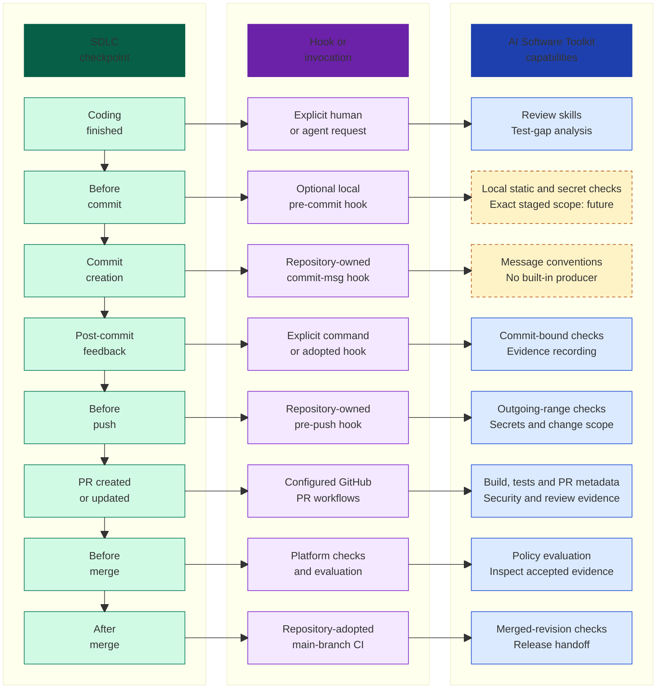
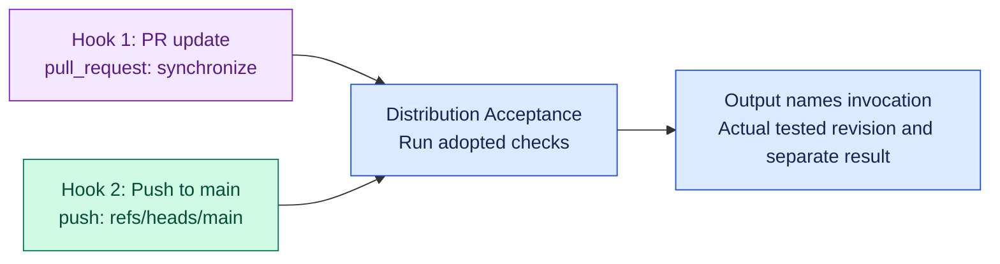
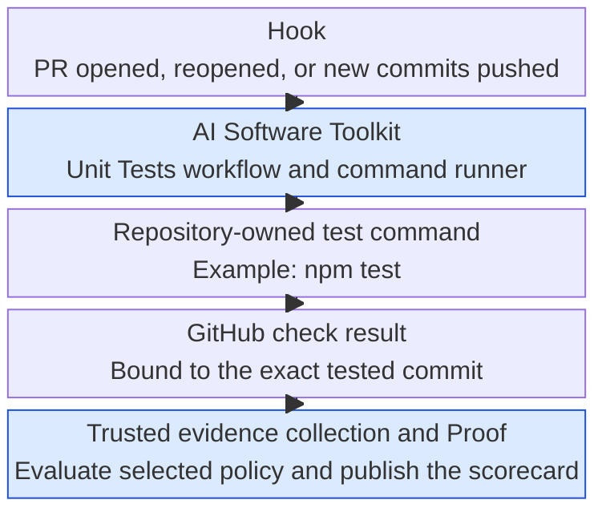

# AI Software Toolkit

**AI is the accelerant. Assurance is mandatory.**

Turn directives into reviewed changes with clear boundaries and evidence for
what actually ran. AI Software Toolkit combines engineering standards, agent
skills, and **Proof**, which binds check results to the evaluated revision.
Your repository owns its commands, acceptance criteria, and release decisions.

[](https://github.com/ravisingh11/ai-software-toolkit/releases/latest)
[](LICENSE)
[](https://ravisingh11.github.io/ai-software-toolkit/)

**All checks are optional to adopt.** Core selects 12 advisory checks. Installing
files, selecting a check, configuring it, executing it, and obtaining passing
evidence are distinct steps. Installation does not enforce checks or change
branch protection. Advanced lifecycle and polyglot execution stay manual.

## Start here

Use Git, Python 3.11+, and a POSIX shell. Preview the starter installation
(Proof and seven skills) before applying it to your application repository:

```sh
git clone --branch v2.3.1 --depth 1 https://github.com/ravisingh11/ai-software-toolkit.git
cd ai-software-toolkit
python3 tooling/ai_toolkit discover --target /path/to/your-repo
python3 tooling/ai_toolkit init --target /path/to/your-repo --clients codex --preview
python3 tooling/ai_toolkit init --target /path/to/your-repo --clients codex --yes
python3 tooling/ai_toolkit doctor --target /path/to/your-repo
```

Replace the target path with your repository. Discovery, preview, and doctor
are read-only; doctor does not run producers. Configure your real commands
before executing checks. Code on `main` may be newer than the published release.
For Claude Code, replace `--clients codex` with `--clients claude-code`.
For Proof without starter skills, explicitly use `--components proof` on both
`init` commands. See [workspace and skill discovery](docs/skill-onboarding.md)
before expecting an agent to find or use installed skills.

[Onboarding](docs/quickstart.md) covers local and CI setup. The
[installation guide](docs/install.md) covers component selection, runtime-only
installs, updates, ownership, and rollback. The
[activation index](docs/activation.md) covers **all 33 checks**, including
prerequisites, execution, evidence, disabling, and optional enforcement.

In v2.3.0, fresh installations default to
`--install-set starter`: Proof, seven starter skills, and 11 Core workflows
covering all 12 advisory Core checks. Existing installations keep their prior
behavior. See [starter and full installation sets](docs/install.md#fresh-starter-installation-v230).

## Use across the SDLC

Place selected checks around the decision you are making. An early review,
a PR check, and a result for merged `main` establish different things.
Read down the first column for the process, and across each row for the
invocation and relevant toolkit capabilities.



Downward arrows show process progression. Across each row, a hook or explicit
request can invoke selected capabilities; this is not an automatically installed
pipeline. Dashed boxes identify current limitations.

The optional local hook bundle provides static and secret checks with its
configured scope. General Proof evaluation of an exact staged snapshot is a
future capability; working-tree results do not prove partially staged contents
passed. Commit-message conventions have no built-in producer. Pre-push hooks,
main-branch CI, and integration-candidate validation require repository adoption.
Local hooks are bypassable and do not replace hosted merge checks.

The [SDLC checkpoint guide](docs/sdlc-checkpoints.md) maps **all 33 checks** to
these checkpoints or later release, deployment, and runtime handoffs. It covers
scope, authority, invalidation rules, partial staging, PR edits, and squash/merge
examples. Existing operations remain `change` and `release`; checkpoint names
are guidance, not new CLI flags. All checks remain optional, Core advisory,
and lifecycle/polyglot manual. The diagram installs no hooks, enables no
triggers, and grants no action authority.

## Two invocation hooks, visible in the output

The diagram uses **teal for decisions**, **purple for invocation**, **blue for
capabilities**, and **dashed amber for limitations**. Labels and line styles
carry the meaning as well as color.

Here, “hook” means an invocation point. These are **GitHub events**, not installed
local Git hooks. The contrast is **before merge: PR update** versus
**after merge: push to main**, using the same **Distribution Acceptance** workflow.



| Hook / invocation | What causes it | What the run describes |
| --- | --- | --- |
| `pull_request:synchronize` | Push a new commit to an open PR's branch. | PR head; output records the actual checkout and PR head/base. Open/reopen events also remain supported. |
| `push` on `refs/heads/main` | A reviewed PR merges into main, or another permitted push updates main. | The actual main revision after the update; earlier PR results keep their original identities. |

This repository adopts the `push` to `main` trigger in its maintainer-only
Distribution Acceptance workflow. That workflow is not distributed as a consumer
default; installed check selection and consumer workflow triggers are unchanged.
All toolkit checks remain optional to adopt, Core advisory, and lifecycle/polyglot
execution manual. These invocations do not deploy or publish anything.

For a committed change on your open PR's branch:

```sh
git push
gh pr checks --required
```

After review, merge only when required CI and repository requirements pass.
Then inspect the **new** main-branch run:

```sh
gh run list --workflow distribution-acceptance.yml --branch main --event push --limit 5
```

Open **Record hook / invocation** in the run log or job summary. It identifies
why the job ran, separately from its outcome. Illustrative output (revision
values are placeholders):

```text
Hook / invocation: GitHub pull_request:synchronize
Checkpoint: PR review readiness
Git ref: refs/pull/<number>/merge
Evidence scope: PR head
Tested revision: <actual PR checkout SHA>
PR head: <head SHA>
PR base: <base SHA>
Result: reported separately by the check; invocation is not a pass
```

```text
Hook / invocation: GitHub push
Checkpoint: Post-merge/main validation
Git ref: refs/heads/main
Evidence scope: Main revision
Tested revision: <actual resulting main SHA>
PR head: not supplied
PR base: not supplied
Result: reported separately by the check; invocation is not a pass
```

A push event does not identify a PR by itself: establish the merge relationship
from the merged PR record and resulting commit. Do not relabel the PR result as
the resulting main commit. The event revision and actual tested revision are
recorded separately, along with the run/attempt link. Invocation labels are
display context, not signed provenance or accepted Proof evidence.

Explicit manual dispatch remains supported, labeled `GitHub workflow_dispatch`
and **Explicit manual verification**; it is a separate invocation, not one of
the two checkpoints above. No local tests are needed to inspect hosted runs.
See the [workflow](https://github.com/ravisingh11/ai-software-toolkit/blob/main/.github/workflows/distribution-acceptance.yml)
and [hosted runs](https://github.com/ravisingh11/ai-software-toolkit/actions/workflows/distribution-acceptance.yml).

## How to invoke it

### Ask an agent to use a skill

After installing skills for your selected client, name the relevant skill and
the decision you want help with. For example, in Codex:

> Use `$code-review` to review my working changes. Read AGENTS.md first.
> Report correctness risks and test gaps. Do not run tests, commit, or push.

Before merging:

> Use `$prepare-safe-change` to assess before-merge using the existing change
> policy and hosted evidence. Identify the tested revision, comparison base,
> missing results, and unresolved findings. Do not run local tests or merge.

The checkpoint describes the task. It does not introduce a new runtime
operation or authorize the next action. See [skill onboarding](docs/skill-onboarding.md)
for client discovery and evidence of actual skill use.

### Inspect readiness without running producers

From your application checkout, use your toolkit source path:

```sh
python3 /path/to/ai-software-toolkit/tooling/ai_toolkit doctor --target .
```

Doctor is read-only. It reports selection, configuration gaps, available
evidence, and next steps; it does not execute producers or enable checks.

### Execute selected local checks when authorized

For a clean, committed feature branch with the installed runtime, available
prerequisites, and a meaningful `origin/main` comparison, an example is:

```sh
export PROOF_UNIT_TEST_COMMAND="npm test"
python3 /path/to/ai-software-toolkit/tooling/ai_toolkit check \
  --target . \
  --operation change \
  --revision "$(git rev-parse HEAD)" \
  --base-ref origin/main
```

Replace the example test command with your repository's real command and
prepare its dependencies first. `check` can execute multiple selected supported
producers and write evidence artifacts. The local scanner uses producer
configuration such as environment variables; the command-runner JSON below is
not automatically its fallback. Missing providers remain visibly unverified.
An advisory `ALLOW` can coexist with unresolved evidence.

If your task excludes local tests, skip this execution step and use hosted CI.
To inspect the current branch's PR required checks from its checkout:

```sh
gh pr checks --required
```

This reads GitHub results. It does not run checks, evaluate every Proof control,
or authorize a merge. Confirm the current head, applicable required checks,
and review requirements before integrating.

## Example: connect unit tests to a checkpoint

Adopt the Unit Tests workflow and configure the repository-owned test command.
When the PR is opened, reopened, or receives new commits, the workflow runs
against the PR head revision:



For a Node application, one optional configuration is `.proof/commands.json`:

```json
{
  "version": 1,
  "setup": "npm ci",
  "working_directory": ".",
  "commands": {
    "unit-tests": "npm test"
  }
}
```

Merge these values into an existing configuration, preserving other adopted
commands. Choose setup and test commands appropriate to your application;
the installer does not create or overwrite this consumer-owned file.
Nonempty corresponding `PROOF_*` variables take precedence. See
[repository command configuration](docs/providers/README.md) for provider setup.

The installed Unit Tests workflow invokes the existing runner in two phases:

```sh
python3 .proof/run_repository_command.py --command unit-tests --phase setup
python3 .proof/run_repository_command.py --command unit-tests --phase producer
```

The runner preserves the command's failure status. A missing command fails the
job rather than becoming passing evidence. GitHub records the tested revision;
the configured trusted collector must accept the correct workflow, provider,
and revision before Proof evaluates that evidence. Running the command runner
alone does not create authoritative CI evidence. Editing only the PR body does
not rerun this unit-test workflow; metadata has its own invalidation rules.

For optional early feedback, your repository could adopt a custom `pre-push`
hook that calls the same runner after dependencies are available:

```sh
#!/bin/sh
exec python3 .proof/run_repository_command.py \
  --command unit-tests --phase producer
```

This is a repository-owned example, not an automatically installed toolkit
hook. Compose it with existing hooks instead of overwriting them. Its exit
status can stop that local push, but it is bypassable, does not satisfy remote
required CI, and does not prove every outgoing commit was tested. Leave it
unconfigured when local tests are excluded. See the
[checkpoint guide](docs/sdlc-checkpoints.md) for evidence scope and boundaries.

## What you can use

| Component | Purpose | Guide |
| --- | --- | --- |
| Proof | Revision-bound results and readable scorecards | [Runtime and evidence](docs/proof/README.md) |
| Skills | Controlled planning, implementation, review, and release procedures | [Skill catalog and installation](skills/README.md) |
| Functional QA | App-specific acceptance criteria and behavioral exploration | [QA bootstrap](skills/qa-bootstrap/SKILL.md) |
| Providers | Repository commands, GitHub checks, and optional scanners | [Provider setup](docs/providers/README.md) |
| Standards | Human-readable engineering expectations | [Standards index](docs/standards/README.md) |
| Specification-driven development | Durable intent, plans, and acceptance evidence using your chosen tools | [Standard and optional Spec Kit integration](docs/standards/spec-driven-development-standard.md) |

<a id="use-with-claude-code"></a>

For Claude Code, use `--components skills --clients claude-code --skills starter`;
for Codex, use `--clients codex`. The same canonical skills populate the selected
client's project directory. Installing a skill does not execute it. See
[client setup](docs/quickstart.md#claude-code-setup) and
[replacement safety](docs/install.md#installing-and-verifying-action-skills).

## Choose what fits your project

| Group | Meaning | Counts toward this evaluation? |
| --- | --- | --- |
| Selected checks | Policy selects the check for the evaluation stage | Yes, when applicable, including failures and unverifiable results |
| Tools available to adopt | Unselected checks useful at this stage | No |
| Checks relevant later | Unselected release or runtime checks | No |

Keep the [33-check activation index](docs/activation.md) available as you adopt
more checks. Provider selection does not prove configuration or execution.
[Independent provenance and Trivy](docs/providers/independent-security.md) can
be adopted separately from advanced lifecycle verification.

<a id="recorded-live-verification-and-cleanup-2026-10-19"></a>

## Read the scorecard

Illustrative evidence for one revision:

| Selected check | Mode | Result |
| --- | --- | --- |
| Unit tests | Advisory | Passed for the evaluated revision |
| Build | Advisory | Failed; inspect the producer log |
| Changed-code coverage | Advisory | Unable to verify; command missing |

Failed, blocked, unverified, and inactive checks remain separate. Missing
credentials, stale evidence, or skipped/manual producers never become a pass.
Only selected, applicable checks affect scores. **Advisory / Enforced** is a
separate choice; `ALLOW` means policy permits that snapshot, not release readiness.
GitHub required merge checks are configured separately.

Inspect the [live toolkit scorecard](https://ravisingh11.github.io/ai-software-toolkit/),
[full illustrative report](docs/examples/sample-scorecard.md), and
[reading evidence guide](docs/proof/reading-evidence.md) for revision binding,
freshness, result states, and provider limitations. Historical verification
records remain in the [provider ledger](docs/providers/verification.md).
The [v2.3.0 compatibility review](docs/releases/v2.3.0-compatibility.md) explains
hosted verification against the published CLI and its limits.

## See it in an application

[Fieldnotes](https://github.com/ravisingh11/ai-software-toolkit-reference-app) is a
TypeScript issue tracker with a [running application](https://ai-software-toolkit-reference-app.navivision-account.workers.dev/),
[live scorecard](https://ravisingh11.github.io/ai-software-toolkit-reference-app/), and
[setup and evidence guide](https://github.com/ravisingh11/ai-software-toolkit-reference-app/blob/main/docs/verification/README.md).
Its [five polyglot quality examples](https://github.com/ravisingh11/ai-software-toolkit-reference-app/tree/main/examples/polyglot)
run manually and do not establish full-application coverage. An
[isolated Python demo](examples/python-demo/README.md) is included here.

<a id="optional-quality-checks"></a>

Choose language tools and thresholds through the
[optional quality recipes](docs/standards/optional-quality-checks.md).

## Repository map

| Path | Purpose |
| --- | --- |
| `policies/` | Check catalog, profiles, providers, engineering policy |
| `proof/`, `tooling/` | Evaluation, installation, producers, validators |
| `workflows/`, `rulesets/` | Optional workflow and enforcement templates |
| `skills/`, `pr-review/`, `prompts/`, `templates/` | Agent procedures and review contracts |
| `security/`, `examples/` | Scanner rules, fixtures, example consumers |
| `docs/` | Onboarding and operating guides |
| `.proof/`, `.github/workflows/`, `.agents/` | This repository's installed runtime and CI |

[Documentation](docs/README.md) explains source ownership and intentional installed
copies. See [contributing](CONTRIBUTING.md), [validation](AGENTS.md#verification),
[vision](docs/vision.md), and [licensing](docs/licensing.md). MIT licensed;
third-party tools retain their own terms.
